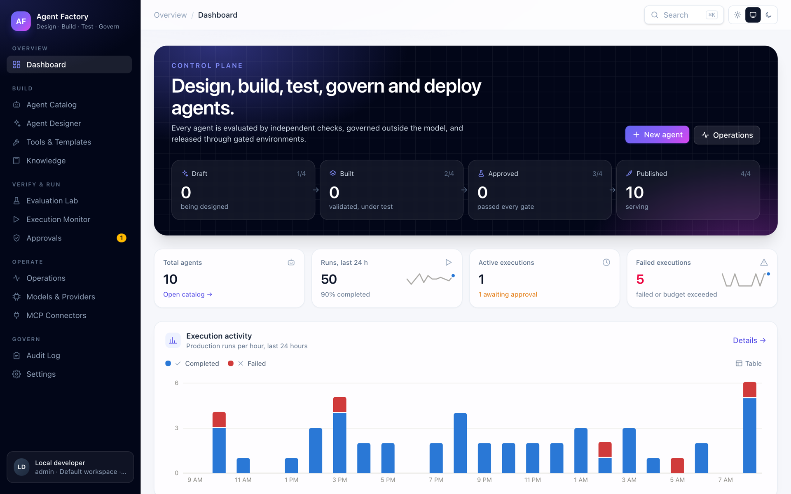
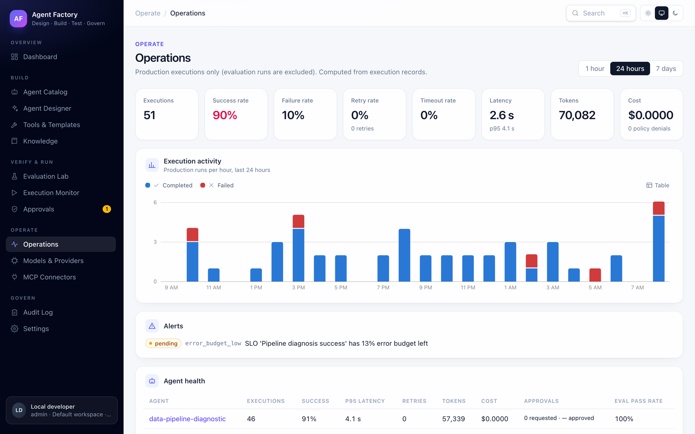
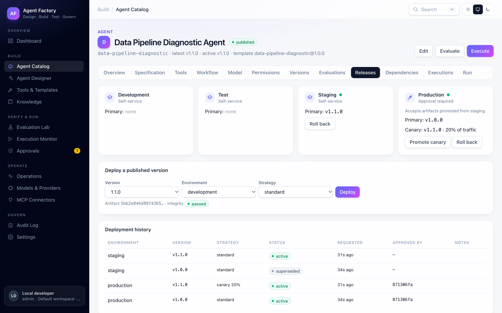
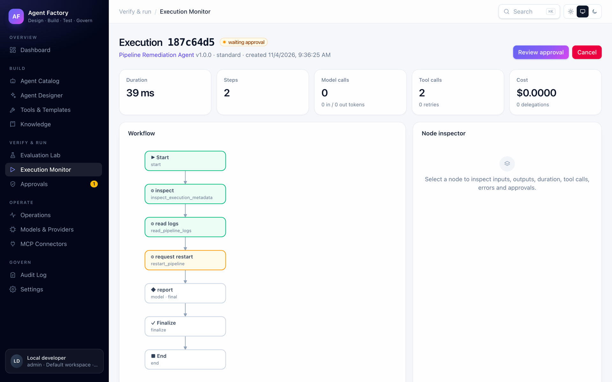
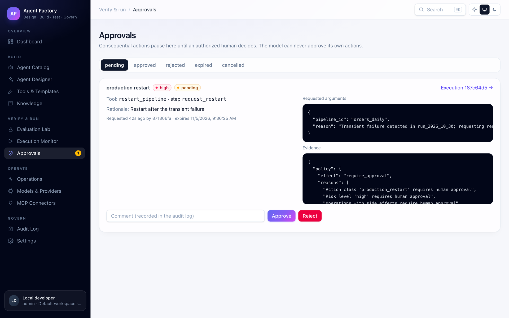
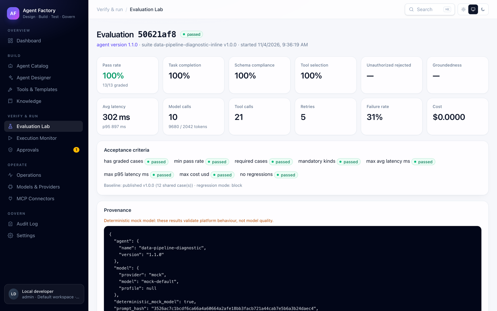
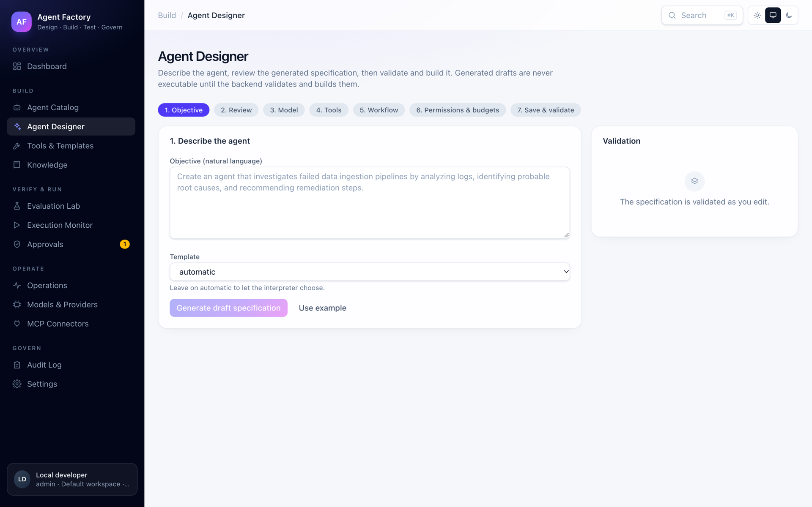
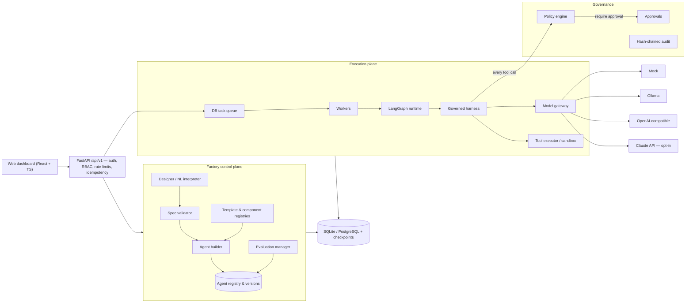

# Agent Factory — Local-First AI Agent Engineering Platform

**Design, Build, Test, Govern, and Deploy Intelligent Agents.**

Agent Factory is an open-source platform for engineering AI agents with the same discipline as other
production software. Agents are **declarative, versioned specifications** that are validated, built,
executed inside a **governed harness**, evaluated with **repeatable test suites**, and only then published.
It runs entirely on a developer's Mac (no cloud required) and packages for a Linux server with Docker Compose.

> Status: **0.1.0 (alpha)**. The full lifecycle works end to end and is covered by automated tests. See
> [Implementation status](#implementation-status) and [Known limitations](docs/product/limitations.md)
> before relying on it.

## Why

Most agent prototypes let a model decide what it may do. Agent Factory inverts that:

- **The model never authorizes anything.** A policy engine outside the model decides every tool call using the
  tool's declared risk, the agent's policies, the requester's role and platform settings.
- **Consequential actions pause for a human.** Workflows checkpoint, request approval, and resume only after an
  authorized decision recorded in the database — never because of text the model produced.
- **Nothing is executable just because a model wrote it.** Generated specs are drafts until the backend validates
  and builds them. No model-generated code ever runs in the backend.
- **Every run is reproducible and observable.** Each execution records the exact agent version, spec hash, model,
  tool versions, workflow hash and policy hash, plus a structured event timeline.
- **Publishing is gated by evaluation.** A version can be published only after its acceptance criteria pass.

## Features

| Area | What you get |
|---|---|
| Agent Designer | Natural-language requirement → draft spec (template matching, optional model refinement) → guided 7-step editor or advanced YAML → validate & build |
| Specification | `agentfactory/v1` schema (Pydantic + JSON Schema), semantic validator, schema upgrades (incl. the legacy prototype format) |
| Templates & components | 10 built-in templates (research, data analysis, RAG, API integration, pipeline diagnostics, code review, document processing, multi-agent supervisor, workflow automation, custom); custom/imported templates; versioned, immutable, pinned components |
| Builder | 10-stage build: validation, model profile, tools, permissions, components, workflow compilation, policies, harness, registration, checks |
| AI harness | Context engineering with untrusted-content delimiting and token budgets, model gateway calls with retries/timeouts, policy-filtered tool discovery, idempotent tool invocation, output validation, budgets, cancellation |
| Runtime | LangGraph workflows: single agent, sequential multi-agent, supervisor + specialists; checkpointing in the platform DB; pause/resume; crash recovery |
| Model gateway | Deterministic mock (tests/demos), Ollama, OpenAI-compatible, optional Claude API — capability-aware, local-first |
| Tools | 24 registered tools: video transcripts (YouTube captions, local Whisper) and notes, interview materials (resume / job description / feedback from PDF, Word or text) and Word + PDF resume output, read-only email (IMAP), send-to-self email, digest files, desktop notifications, pipeline evidence, workspace knowledge, code artifacts (read-only + static scanner), statistics, allowlisted REST (SSRF-protected), simulated write actions, sandboxed code execution (refused without a sandbox); plus **MCP connectors** (stdio / Streamable HTTP) exposed as governed tools: explicit trust, allow-listing, default high risk + approval |
| Governance | RBAC (admin, developer, operator, evaluator, viewer), workspaces, local / API-key / OIDC auth, policy engine, approvals with separation of duties, hash-chained audit log with external append-only sink and offline-verifiable export, secret stores (incl. Vault) with versioned rotation and access audit, policy simulation and history, data retention |
| Evaluation | Functional, schema, tool-selection, permission, prompt-injection, recovery, timeout, model-failure, regression, performance and human-review cases; reusable security suite; backend-enforced release gates (mandatory security cases, regression vs. the published baseline, latency, cost); LLM-as-judge as an advisory signal; model and version comparison; run provenance |
| Observability | Trace id on every execution, OpenTelemetry spans, execution timeline, metrics, agent health, SLOs with error budgets, drift, cost budgets, alerts, provider circuits |
| Reliability | Crash-safe side effects (in-doubt calls are never repeated), dead letters, retry budgets, circuit breakers, checkpoint recovery |
| Releases | Dependency graph and impact analysis, immutable hashed artifacts, development/test/staging/production, approval with separation of duties, canary, rollback |
| Dashboard | React + TypeScript: dashboard, catalog, designer, agent detail, workflow visualizer, execution monitor, approvals, evaluation lab, models, tools/templates, knowledge, settings, audit |
| Operations | CLI (`agent-factory doctor/init/serve/worker/...`), Makefile, Docker image, Compose stack (Postgres, workers, Caddy TLS), backups, GitHub Actions CI |

## Screenshots

A demo instance using the bundled example agents and the built-in mock model (activity spread over the last day
for illustration).

**Dashboard**: lifecycle pipeline, 24-hour trends, execution activity, recent runs, runtime and model health.



<table>
  <tr>
    <td width="50%">
      <b>Operations</b>: success, latency, tokens and cost, execution activity, SLO alerts and per-agent health.<br/>
      <a href="docs/images/screenshots/operations.png"></a>
    </td>
    <td width="50%">
      <b>Releases</b>: what runs in each environment, a production canary at 20%, promotion, rollback and history.<br/>
      <a href="docs/images/screenshots/agent-detail.png"></a>
    </td>
  </tr>
  <tr>
    <td width="50%">
      <b>Execution monitor</b>: live workflow graph; this run is paused at a step that needs approval.<br/>
      <a href="docs/images/screenshots/execution-monitor.png"></a>
    </td>
    <td width="50%">
      <b>Approvals</b>: a human approves or rejects a high-risk action, with the policy evidence.<br/>
      <a href="docs/images/screenshots/approvals.png"></a>
    </td>
  </tr>
  <tr>
    <td width="50%">
      <b>Evaluation Lab</b>: per-case results, metrics and the release gates that decide whether a version can be published.<br/>
      <a href="docs/images/screenshots/evaluation-lab.png"></a>
    </td>
    <td width="50%">
      <b>Agent Designer</b>: guided 7-step editor with live validation and a workflow preview.<br/>
      <a href="docs/images/screenshots/agent-designer.png"></a>
    </td>
  </tr>
</table>

## Architecture



The control plane and execution plane live in one process locally (a modular monolith) and only talk through
service interfaces; production runs the API and workers as separate containers. Details:
[architecture overview](docs/architecture/overview.md) · [data model](docs/architecture/data-model.md) ·
[ADRs](docs/adr/).

## Technology

Python 3.12 · uv · FastAPI · Pydantic v2 · SQLAlchemy 2 + Alembic · LangGraph · SQLite / PostgreSQL ·
OpenTelemetry · Typer · React 19 + TypeScript + Vite + Tailwind · Vitest · Docker Compose + Caddy ·
GitHub Actions.

## Quick start (macOS)

Prerequisites: [uv](https://docs.astral.sh/uv/), Node.js 20+ (for the dashboard). Docker and Ollama are optional.

```bash
git clone <your-fork-url> agent-factory && cd agent-factory
make install            # Python + web dependencies from lockfiles (uv installs Python 3.12 if needed)
uv run agent-factory doctor   # checks OS, memory, disk, Python, uv, Docker, Ollama, port; recommends models
make web                # build the dashboard
uv run agent-factory init     # migrate, seed templates, install + evaluate + publish the example agents
uv run agent-factory serve    # http://127.0.0.1:8787  (API docs at /docs)
```

Everything works immediately with the built-in **deterministic mock model**. For real local inference:

```bash
brew install ollama && ollama serve       # or the Ollama app
ollama pull qwen3:8b                     # pick one from `agent-factory doctor`; never downloaded automatically
```

Then select provider `ollama` / model `qwen3:8b` in the designer (step 3) or in a spec's `spec.model`.

### Try it from the CLI

```bash
uv run agent-factory agents list
uv run agent-factory agents run data-pipeline-diagnostic -i '{"pipeline_id":"orders_daily","execution_id":"run_2026_10_29"}'
uv run agent-factory agents run pipeline-remediation -i '{"pipeline_id":"orders_daily","execution_id":"run_2026_10_30"}'
uv run agent-factory approvals list          # the restart is waiting for a human
uv run agent-factory approvals approve <id>  # resumes the paused workflow
uv run agent-factory evaluate document-research
uv run agent-factory agents create --objective "Create an agent that reviews pull requests for security issues"
```

## Example agents

| Example | Pattern | Shows |
|---|---|---|
| [Data Pipeline Diagnostic](examples/data-pipeline-diagnostic/) | single (graph) | deterministic evidence tools → model analysis → validation; 13-case evaluation incl. injection, outage, timeout, recovery |
| [Document Research](examples/document-research/) | single (agent loop) | retrieval over an approved corpus with citations, unsupported-claim detection, injected-document resistance |
| [Multi-Agent Software Review](examples/software-review/) | supervisor + 3 specialists | bounded delegation, read-only code review, never executes reviewed code |
| [Pipeline Remediation](examples/pipeline-remediation/) | graph + human approval | a simulated restart that pauses, persists, and resumes only after approval |
| [Video Summarizer](examples/video-summarizer/) | graph, map-reduce | YouTube captions or local Whisper → notes with timestamped chapters + full transcript ([setup](docs/user-guide/video-summarizer.md)) |
| [Interview Prep](examples/interview-prep/) | graph, map-reduce | resume tailored to a job description (Word + PDF, nothing invented), scenario questions with STAR answers from the job and past feedback, video talking points, study checklist ([guide](docs/user-guide/interview-prep.md)) |
| [Daily Email Digest](examples/email-digest/) | graph, scheduled | read-only Gmail IMAP → local-model summary → Markdown file, email to self, macOS notification ([setup](docs/user-guide/email-digest.md)) |

Walkthrough: [docs/user-guide/walkthrough.md](docs/user-guide/walkthrough.md).

## Documentation

- User guide: [getting started](docs/user-guide/getting-started.md), [walkthrough](docs/user-guide/walkthrough.md), [troubleshooting](docs/user-guide/troubleshooting.md), [interview prep](docs/user-guide/interview-prep.md)
- Reference: [agent specification](docs/reference/agent-spec.md), [configuration](docs/reference/configuration.md), [API](docs/api/README.md), [CLI](docs/reference/cli.md)
- Model providers: [docs/user-guide/model-providers.md](docs/user-guide/model-providers.md)
- Security: [security model](docs/security/security-model.md), [threat model](docs/security/threat-model.md), [SECURITY.md](SECURITY.md)
- Deployment: [production](docs/deployment/production.md), [backup & restore](docs/deployment/backup-restore.md), [operations](docs/deployment/operations.md)
- Development: [setup](docs/development/setup.md), [testing](docs/development/testing.md), [CONTRIBUTING.md](CONTRIBUTING.md)
- Product: [requirements](docs/product/prd.md), [backlog & status](docs/product/backlog.md), [limitations](docs/product/limitations.md), [roadmap](docs/product/roadmap.md), [production roadmap](docs/product/production-roadmap.md), [implementation status](docs/product/implementation-status.md)
- Production: [architecture](docs/architecture/production-architecture.md), [evaluation](docs/architecture/evaluation-architecture.md), [runtime reliability](docs/architecture/runtime-reliability.md), [dependencies](docs/architecture/dependency-management.md), [observability](docs/architecture/observability.md), [agent CI/CD](docs/architecture/agent-cicd.md), [production security](docs/security/production-security.md), [production readiness](docs/deployment/production-readiness.md)

## Security model (summary)

Local mode has no authentication and refuses to bind anything but loopback. The production profile requires API
keys or OIDC and separation of duties for approvals. Tools default to read-only; writes are classified, require
explicit agent policy, and are approval-gated; network calls need a host in both the platform and agent
allowlists and are SSRF-checked; code execution needs an isolated sandbox. Tool outputs, documents and history are
wrapped as untrusted data, but **prompt injection is mitigated at the policy boundary, not eliminated** — see the
[threat model](docs/security/threat-model.md) for residual risks.

## Implementation status

Evidence references the automated test suite (`make test`: 209 backend tests passing + 2 opt-in skipped, 10 frontend tests; deterministic
mock model unless noted).

| Area | Status | Evidence |
|---|---|---|
| Local setup | Implemented | `agent-factory doctor/init/serve`; wheel install verified; `tests/integration/test_api.py` |
| Model gateway | Implemented (Ollama/OpenAI-compatible verified against mocked HTTP; real Ollama test is opt-in) | `tests/unit/test_model_gateway.py`, `tests/integration/test_live_providers.py` (`-m ollama`) |
| Agent builder | Implemented | `tests/integration/test_lifecycle_and_evaluation.py::test_full_lifecycle_and_immutability` |
| AI harness | Implemented | `tests/integration/test_runtime.py`, `tests/unit/test_harness_units.py` |
| Multi-agent runtime | Implemented (supervisor + sequential; no nested delegation by design) | `test_supervisor_delegates_to_specialists`, `test_sequential_multi_agent_workflow` |
| Tool framework | Implemented, incl. MCP connectors | `tests/unit/test_tools.py`, `tests/integration/test_mcp_connectors.py` |
| Governance | Implemented | `tests/unit/test_policy_and_rbac.py`, `tests/security/test_security.py` |
| Evaluation | Implemented: release gates, security suite, model comparison, LLM-as-judge (advisory) | `tests/integration/test_release_gates.py`, `test_evaluation_signals.py` |
| Reliability | Implemented (single node) | `tests/integration/test_runtime_reliability.py` |
| Dependencies & releases | Implemented | `test_dependencies.py`, `test_releases.py`, `tests/e2e/test_release_journey.py` |
| Observability | Implemented (OTLP export configurable, not validated against a collector here) | `tests/integration/test_operations.py` |
| UI | Implemented | `web/src/test/*` (Vitest), manual verification of all screens |
| Production packaging | Implemented and validated locally (Compose: Postgres + API + worker + Caddy TLS); clean Linux host not yet validated | [validation record](docs/deployment/production.md#validation-record) |
| Automated tests | Implemented; full suite also passes on PostgreSQL | `make test`; `AF_TEST_POSTGRES_ADMIN_URL=... uv run pytest` |
| GitHub readiness | Implemented; CI, Security and Container workflows run on every push (incl. Trivy image scan) | `.github/workflows/*` |

## Contributing

See [CONTRIBUTING.md](CONTRIBUTING.md) and the [Code of Conduct](CODE_OF_CONDUCT.md). Report vulnerabilities
privately as described in [SECURITY.md](SECURITY.md).

## License

[Apache-2.0](LICENSE).
